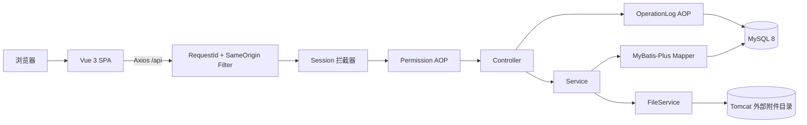
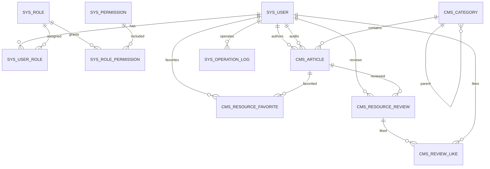
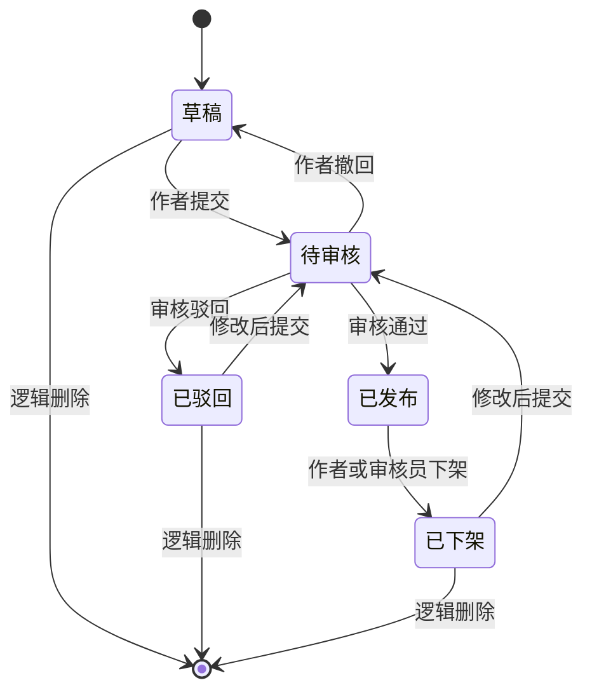
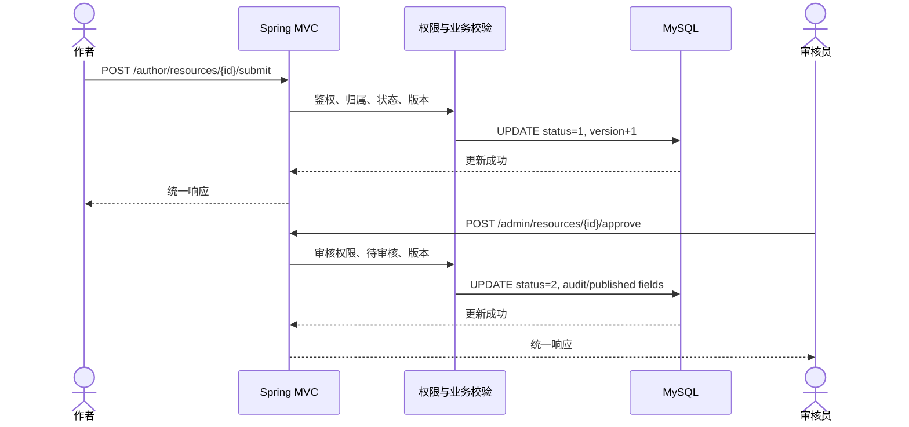

# CourseShare 学习资源分享平台详细设计

## 1. 项目概览

### 1.1 项目定位

CourseShare 是基于传统 Spring Framework 6 + Spring MVC + MyBatis-Plus 的学习资源 CMS，不使用 Spring Boot。系统面向课程资源共享场景，完成“资源创建 → 提交审核 → 审核发布 → 门户检索 → 登录下载”的完整业务链路。

### 1.2 技术栈

| 层级 | 技术 |
|---|---|
| 后端 | Java 17、Spring Framework 6.1、Spring MVC、MyBatis-Plus 3.5、HikariCP |
| 数据库 | MySQL 8、InnoDB、utf8mb4 |
| Web 容器 | Tomcat 10.1、Jakarta Servlet 6、WAR |
| 前端 | Vue 3、TypeScript、Vite、Vue Router、Pinia、Element Plus |
| 内容渲染 | markdown-it + DOMPurify |
| 测试 | JUnit 5、Mockito、Spring Test、MockMvc、ApiFox |

### 1.3 系统边界

本版本包含：

- 游客浏览资源、分类和详情。
- 注册用户登录、个人资料和附件下载。
- 作者创建、编辑、提交、撤回、下架和删除自己的资源。
- 审核员审核、驳回、批量发布和下架资源。
- 管理员维护分类、用户角色和操作日志。
- 登录用户收藏资源、发布五星短评和点赞他人评价。
- 游客查看评价，浏览历史保存在当前浏览器。
- 门户提供最新、综合热门、高分和评价获赞发现榜单。
- 统一异常、请求 ID、权限拦截、日志脱敏和文件安全。

本版本不包含：

- 跨设备浏览历史、个性化推荐、评价预审核和敏感词自动检测。
- 付费、即时通信、消息队列和微服务。
- Redis、对象存储和多节点集群部署。

## 2. 总体架构



### 2.1 后端目录

```text
com.courseshare
├── common
│   ├── api          ApiResponse、PageResult
│   ├── entity       BaseEntity
│   ├── exception    错误码、业务异常、全局异常处理
│   ├── filter       请求 ID、同源保护
│   ├── handler      MyBatis 自动填充
│   └── util         分页和客户端 IP
├── config
│   ├── RootConfig   数据源、MyBatis-Plus、事务、密码编码器
│   └── WebConfig    MVC、拦截器、AOP、静态资源
├── auth
│   ├── annotation   @RequireAuth、@RequirePermission
│   ├── aspect       权限切面
│   ├── controller
│   ├── interceptor
│   ├── model
│   ├── service
│   └── vo
├── user
│   ├── controller
│   ├── dto
│   ├── entity
│   ├── mapper
│   ├── service
│   └── vo
├── category
│   ├── controller
│   ├── dto
│   ├── entity
│   ├── mapper
│   ├── service
│   └── vo
├── resource
│   ├── controller
│   ├── dto
│   ├── entity
│   ├── mapper
│   ├── model
│   ├── service
│   └── vo
├── interaction
│   ├── controller   收藏、评价、管理员评价管理和发现页
│   ├── dto          评价写入与可见性请求
│   ├── entity       资源评价
│   ├── mapper       收藏、评价和点赞 Mapper
│   ├── service      收藏、评价和发现榜单服务
│   └── vo           评价、个人评价和发现资源
└── log
    ├── annotation
    ├── aspect
    ├── controller
    ├── dto
    ├── entity
    ├── mapper
    └── service
```

依赖方向为 Controller → Service → Mapper。Controller 不直接访问 Mapper，Service 负责归属、状态和事务校验。

### 2.2 前端目录

```text
frontend/src
├── api           Axios 客户端、DTO 类型、接口封装
├── components    资源卡片、收藏按钮、评价区、分类树和 Markdown 渲染
├── layouts       公共服务门户、作者/管理控制台
├── router        路由和权限守卫
├── stores        登录用户、收藏集合与本机浏览历史
├── styles        全局设计变量和基础样式
└── views
    ├── author    作者资源和资源编辑器
    └── admin     审核、分类、用户和日志
```

### 2.3 部署结构

- 开发环境：Vite 运行于 5173，`/api` 代理到 `http://localhost:8080/course-share`。
- 生产环境：前端构建结果加入 WAR 根目录，与 `/api` 同源部署。
- 数据库和附件目录通过外部属性配置。
- 附件存储于 Web 根目录之外，数据库仅保存随机相对路径。
- Vue Router 使用 history 模式，`SpaController` 将前端路由转发到 `index.html`。

## 3. 数据库设计

### 3.1 E-R 关系



### 3.2 表结构

#### `sys_user`

| 字段 | 类型 | 说明 |
|---|---|---|
| `id` | BIGINT UNSIGNED PK | 用户 ID |
| `username` | VARCHAR(50) UK | 登录账号 |
| `password_hash` | VARCHAR(100) | BCrypt 密文 |
| `nickname` | VARCHAR(50) | 展示名称 |
| `email` | VARCHAR(100) UK NULL | 邮箱 |
| `status` | TINYINT | 1 启用，0 停用 |
| `last_login_at` | DATETIME(3) | 最后登录时间 |
| `created_at` / `updated_at` | DATETIME(3) | 审计时间 |
| `deleted` | TINYINT | 逻辑删除 |

#### `sys_role`

字段：`id`、`code`、`name`、`description`、`status`、`created_at`、`updated_at`。`code` 与 `name` 均有唯一索引。

#### `sys_permission`

字段：`id`、`code`、`name`、`module`、`http_method`、`path`、`description`、`status`、`created_at`、`updated_at`。权限编码唯一。

#### `sys_user_role`

字段：`user_id`、`role_id`、`created_at`，联合主键 `(user_id, role_id)`。

#### `sys_role_permission`

字段：`role_id`、`permission_id`、`created_at`，联合主键 `(role_id, permission_id)`。

#### `cms_category`

| 字段 | 类型 | 说明 |
|---|---|---|
| `id` | BIGINT UNSIGNED PK | 分类 ID |
| `parent_id` | BIGINT UNSIGNED NULL FK | 父分类 |
| `name` | VARCHAR(50) | 分类名称 |
| `level` | TINYINT | 1-3 |
| `sort_order` | INT | 同级升序 |
| `status` | TINYINT | 启停状态 |
| `description` | VARCHAR(255) | 说明 |
| `version` | INT UNSIGNED | 乐观锁 |
| `created_at` / `updated_at` | DATETIME(3) | 审计时间 |
| `deleted` | TINYINT | 逻辑删除 |

索引：`(parent_id, status, sort_order, deleted)`、`(parent_id, name)`。

#### `cms_article`

| 字段 | 类型 | 说明 |
|---|---|---|
| `id` | BIGINT UNSIGNED PK | 资源 ID |
| `title` | VARCHAR(200) | 标题 |
| `summary` | VARCHAR(500) | 摘要和检索字段 |
| `content` | MEDIUMTEXT | Markdown 正文 |
| `category_id` | BIGINT UNSIGNED FK | 分类 |
| `author_id` | BIGINT UNSIGNED FK | 作者 |
| `attachment_name` | VARCHAR(255) | 原始文件名 |
| `attachment_path` | VARCHAR(500) | 随机相对路径 |
| `attachment_ext` | VARCHAR(20) | 白名单扩展名 |
| `attachment_mime` | VARCHAR(100) | MIME |
| `attachment_size` | BIGINT UNSIGNED | 文件大小 |
| `status` | TINYINT | 0 草稿、1 待审核、2 已发布、3 已驳回、4 已下架 |
| `audit_by` / `audit_at` | BIGINT / DATETIME(3) | 审核信息 |
| `audit_remark` | VARCHAR(500) | 审核意见 |
| `published_at` | DATETIME(3) | 发布时间 |
| `view_count` / `download_count` | BIGINT UNSIGNED | 浏览与下载次数 |
| `version` | INT UNSIGNED | 乐观锁 |
| `created_at` / `updated_at` | DATETIME(3) | 审计时间 |
| `deleted` | TINYINT | 逻辑删除 |

索引：

- `(status, deleted, category_id, published_at)`
- `(author_id, deleted, status, updated_at)`
- `(status, deleted, created_at)`
- `(attachment_path)`

#### `sys_operation_log`

字段：`id`、`request_id`、`user_id`、`username_snapshot`、`module`、`action`、`http_method`、`uri`、`ip`、`duration_ms`、`success`、`error_code`、`error_message`、`params_json`、`created_at`。

索引：`(created_at)`、`(user_id, created_at)`、`(module, created_at)`、`(request_id)`。

#### `cms_resource_favorite`

字段：`user_id`、`resource_id`、`created_at`。联合主键保证同一账号对同一资源只有一条收藏记录；资源或账号删除时级联删除。

#### `cms_resource_review`

字段：`id`、`resource_id`、`user_id`、`score`、`content`、`status`、`like_count`、`created_at`、`updated_at`。

唯一键 `(user_id, resource_id)` 保证一人一评；`status=1` 表示公开，`status=0` 表示被管理员隐藏。隐藏评价保留给作者查看，但不进入公开列表和评分统计。

#### `cms_review_like`

字段：`review_id`、`user_id`、`created_at`。联合主键保证一人对一条评价最多点赞一次，评价删除时级联删除点赞。

## 4. 功能与状态设计

### 4.1 RBAC

| 角色 | 权限范围 |
|---|---|
| USER | 下载已发布资源 |
| AUTHOR | 下载、创建、编辑、提交、撤回、下架和删除本人资源 |
| AUDITOR | 下载、查看审核队列、审核、批量发布、下架任意资源 |
| ADMIN | 全部资源、审核、分类、用户角色、评价管理和日志权限 |

权限检查分两层：

1. `@RequirePermission` AOP 检查接口级权限编码。
2. Service 校验作者归属、当前状态和数据版本。

当前用户每次受保护请求都会从数据库读取最新账号状态、角色和权限。账号停用或角色撤销立即生效。

### 4.2 资源状态机



### 4.3 收藏、历史与评价

- 收藏保存在 MySQL，按登录账号跨设备同步；收藏列表只返回仍发布且分类启用的资源。
- 浏览历史保存在浏览器 `courseshare:history:v1`，按最近浏览去重，最多 100 项，不按账号隔离。
- 评价使用 1–5 星和最多 500 字纯文本短评；作者不能评价自己的资源，用户可以点赞自己的评价。
- 综合热度为 `浏览量 + 5×下载量 + 10×收藏数 + 8×评分人数 + 2×评价点赞数`。
- 高分榜只包含至少一条可见评价的资源；评价获赞榜只包含至少一个有效评价点赞的资源。

编辑仅允许草稿、驳回和下架状态。已发布资源必须先下架再编辑，避免未审核内容直接覆盖线上内容。

### 4.4 发布审核时序



### 4.5 分类规则

- 最多三级。
- 同级名称不可重复。
- 修改父分类时检查自引用和父子循环。
- 移动分类时检查后代最大深度。
- 停用父分类原子级联停用所有后代。
- 停用分类下资源保留数据，但对门户隐藏且禁止下载。
- 有子分类或未删除资源时禁止删除分类。
- 点击父分类查询资源时包含全部后代分类。

### 4.6 检索与性能

- 关键词仅匹配标题和摘要。
- 用户输入中的 `%`、`_` 和反斜杠会被转义。
- 公开列表固定条件为已发布、未删除、分类启用。
- 分类后代 ID 通过一次分类列表查询计算。
- 列表使用一条 count 与一条联表数据 SQL。
- 排序字段由白名单映射，不直接拼接客户端 SQL。
- 浏览和下载次数使用原子 `count + 1`。

### 4.7 文件和日志安全

- 扩展名白名单：PDF、Word、Excel、PowerPoint、Markdown、TXT、ZIP。
- 使用随机存储名，原始文件名只作为展示。
- 文件根目录外置，下载时校验路径真实位置。
- 下载固定为 `application/octet-stream`，附件通过 `Content-Disposition` 返回。
- 数据库事务回滚时清理新文件，提交后清理被替换的旧文件。
- 日志忽略 HttpServletRequest、ServletResponse 和文件内容。
- 包含 password、token、secret、session、authorization 的参数值统一替换为 `***`。
- 日志使用 `REQUIRES_NEW` 独立事务，业务失败不会丢失失败记录。

## 5. 接口设计

完整说明见 [API 文档](api.md)。核心约定：

```json
{
  "code": "SUCCESS",
  "message": "成功",
  "data": {},
  "requestId": "..."
}
```

分页：

```json
{
  "records": [],
  "total": 42,
  "page": 1,
  "size": 10,
  "pages": 5
}
```

| 模块 | 主要接口 |
|---|---|
| 认证 | `/api/auth/register`、`login`、`logout`、`me` |
| 门户 | `/api/categories/tree`、`/api/resources`、`/{id}`、`/{id}/download` |
| 作者 | `/api/author/resources` 及提交、撤回、下架、删除 |
| 审核 | `/api/admin/resources` 及通过、驳回、批量发布、下架、删除 |
| 分类 | `/api/admin/categories` 及状态和删除 |
| 用户 | `/api/admin/users`、`/roles`、角色分配、账号状态 |
| 日志 | `/api/admin/logs` |

## 6. 前端页面设计

### 6.1 视觉规范

| 项目 | 规范 |
|---|---|
| 主色 | #2563EB |
| 成功 / 警告 / 危险 | #16A34A / #F59E0B / #DC2626 |
| 正文 / 次要文字 | #1F2937 / #64748B |
| 背景 / 卡片 / 边框 | #F7F9FC / #FFFFFF / #E5E7EB |
| 字体 | Noto Sans SC / Microsoft YaHei |
| 代码字体 | JetBrains Mono / Consolas |
| 内容宽度 | 1200px |
| 卡片圆角 | 12px |

风格关键词：清爽、学术、可信、内容优先。首页使用轻渐变和资源卡片，后台使用深色侧栏与浅色内容区。动画只用于反馈和资源卡片悬停。

### 6.2 页面清单

| 路由 | 页面职责 |
|---|---|
| `/` | 首页搜索、分类入口、最近发布和热门资源 |
| `/resources` | 左侧分类树、关键词、白名单排序、分页 |
| `/resources/:id` | 资源详情、Markdown 正文、附件下载和相关资源 |
| `/login`、`/register` | 登录与注册 |
| `/profile` | 用户角色、权限和工作入口 |
| `/author/resources` | 作者资源状态列表和状态操作 |
| `/author/resources/new` | Markdown 编写、附件上传、实时预览 |
| `/author/resources/:id/edit` | 编辑可修改资源 |
| `/admin/resources` | 审核队列、详情抽屉、批量发布和驳回 |
| `/admin/categories` | 分类树表格、排序、移动、启停和删除 |
| `/admin/users` | 用户筛选、角色分配和账号启停 |
| `/admin/logs` | 日志筛选、结果状态和脱敏参数详情 |

前端必须同时提供加载、空数据、403、404、401 跳转和错误提示状态。前端权限控制只决定导航和按钮可见性，后端权限检查才是最终依据。

## 7. 测试与验收

### 7.1 已实现自动化测试

- 资源提交从草稿进入待审核。
- 作者不能操作他人资源。
- 资源旧版本返回版本冲突。
- 审核通过后写入发布字段。
- 分类拒绝第四级。
- 拒绝在停用父分类下创建启用子分类。
- MockMvc 验证公开资源分页统一响应。

### 7.2 ApiFox 必须覆盖

- 注册重复账号、错误密码、停用账号。
- 未登录 401、权限不足 403。
- 资源创建、编辑、提交、撤回、审核、驳回、下架和删除。
- 非法状态转换和重复审核返回 409。
- 批量发布中任一条过期时整批回滚。
- 分类三级限制、循环、级联停用、非空分类删除。
- 非法附件、大文件和路径穿越。
- 发布/停用分类下的资源可见性。
- 分页、关键词、分类后代、时间和排序组合。
- 日志成功/失败、脱敏和请求 ID。

### 7.3 性能验证

- 公开资源列表每页 SQL 数量固定：1 条 count、1 条联表数据查询。
- 使用 `EXPLAIN` 验证文章公开索引、作者索引和审核索引。
- 批量发布使用单条带 `(id, version)` 条件更新。

## 8. 评分表对应

| 评分维度 | 项目证据 |
|---|---|
| 项目架构与数据库 | 架构、ER、状态图、十一表 SQL、分层目录 |
| 基础核心功能 | 登录、RBAC、AOP、分类、审核、检索、日志和异常 |
| 进阶功能 | MP 分页/逻辑删除/自动填充/乐观锁、联表查询、批量更新 |
| RESTful 与联调 | 统一响应、语义 HTTP 状态、ApiFox 可导入接口说明 |
| 代码规范 | 业务域分层、DTO/VO、统一异常和权限模型 |
| 健壮性 | 文件安全、归属校验、状态机、版本冲突和补偿清理 |
| AI 合理应用 | 保存 [AI 使用记录模板](ai-log-template.md) 与 Git 修改痕迹 |
| 部署与文档 | 建表脚本、初始化数据、WAR、前端构建和部署说明 |

